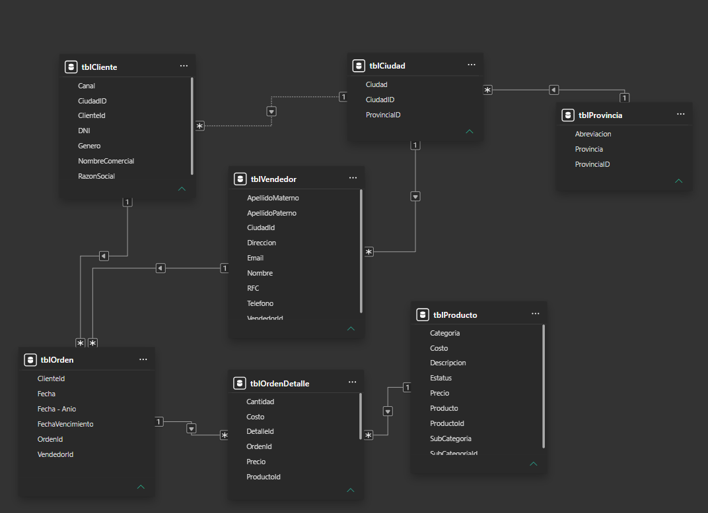

[← Volver al portafolio](/)

# Dashboard de Ventas: Análisis Comercial Regional en Sudamérica

Power BIPower QueryDAXModelado de datosETLStorytelling

$14.805ingresos totales

4ciudades analizadas

45transacciones

7productos clave

## 📝 Descripción general

> Desarrollo de un dashboard interactivo en **Microsoft Power BI** para el análisis de ventas de una empresa comercial con presencia en 4 ciudades de Sudamérica. El proyecto transforma datos transaccionales en información accionable, permitiendo identificar tendencias, patrones de consumo y oportunidades de negocio.

## 🎯 Objetivos del proyecto

- Consolidar datos dispersos en un **modelo relacional** (3 tablas: Clientes, Productos, Ventas).

- Visualizar **KPIs clave** para la toma de decisiones (ventas totales, ticket promedio, crecimiento, concentración de clientes).

- Detectar **estacionalidad**, productos estrella y ciudades con mayor potencial.

- Facilitar el **análisis dinámico** mediante segmentadores interactivos.

## 🛠️ Metodología y proceso

### 1. Modelado de datos

- Normalización en 3 tablas relacionadas con claves foráneas (`ID_Cliente`, `ID_Producto`).

- Cobertura de **20 clientes**, **7 productos** y **45 transacciones** distribuidas en 8 meses.

- Distribución geográfica intencional: Buenos Aires (40%), Córdoba (25%), Santiago de Chile (20%) y Montevideo (15%).

### 2. Limpieza y transformación (Power Query)

- Corrección de configuración regional (`en-US`) para interpretación correcta de decimales.

- Tipificación y validación de columnas (moneda, fecha, enteros).

### 3. Desarrollo de medidas DAX

- **Agregación**: `SUM`, `COUNTROWS`, `DISTINCTCOUNT` para KPIs generales.

- **Comparación temporal**: Cálculo de último mes vs. mes anterior utilizando `EDATE`, `FILTER`, `YEAR` y `MONTH`.

- **Ranking y agregados complejos**: Implementación de `TOPN`, `MAXX` y `ADDCOLUMNS`.

- **Formato condicional**: Indicadores con `FORMAT` y `UNICHAR` para alertas y flechas visuales.

### 4. Visualización y experiencia de usuario

- **Tarjetas KPI** con semáforo de color (verde/rojo según variación mensual).

- **Gráfico de líneas** para evolución mensual con tooltips enriquecidos.

- **Gráfico de barras** para ranking de categorías y **gráfico de anillo** para distribución geográfica.

- **Segmentadores interactivos** para filtrado dinámico por ubicación y categoría.

## 💡 Hallazgos clave del análisis

| Insight / Métrica | Detalle y Oportunidad de Negocio |
| --- | --- |
| Dominio de Electrónica | Concentra el **77% de los ingresos** ($11.549 de $14.805) |
| Liderazgo geográfico | **Buenos Aires** encabeza las ventas con el **48,5%** del total |
| Valles de demanda | Caídas en **marzo y junio** señalan momentos clave para promociones |
| Crecimiento de ticket | Ticket promedio creció **+30,9% en agosto vs. julio** (mejor mix de productos) |
| Concentración de clientes | Dependencia moderada: Top 5 clientes representan el **~41% de ingresos** |

## 🧰 Stack técnico

Microsoft Power BI DesktopPower Query (ETL y transformación)DAX (Data Analysis Expressions)Modelo estrella (tablas de hechos y dimensiones)CSV como fuente de datos

## 🚀 Habilidades demostradas

- Modelado de datos relacionales y diseño de esquemas.

- Limpieza, estructuración y transformación de datos en Power Query.

- Desarrollo de medidas DAX avanzadas y time intelligence.

- Diseño de visualizaciones efectivas e interfaces orientadas a decisiones.

- Comunicación visual de insights de negocio y storytelling.

- Configuración de interactividad (tooltips, segmentadores, formato condicional).

## 📌 Resultado

Un dashboard funcional, estético y accionable que permite al usuario explorar el negocio desde múltiples ángulos (tiempo, geografía, categoría, producto) y tomar decisiones estratégicas basadas en datos reales.

 

[← Volver al portafolio](/)
